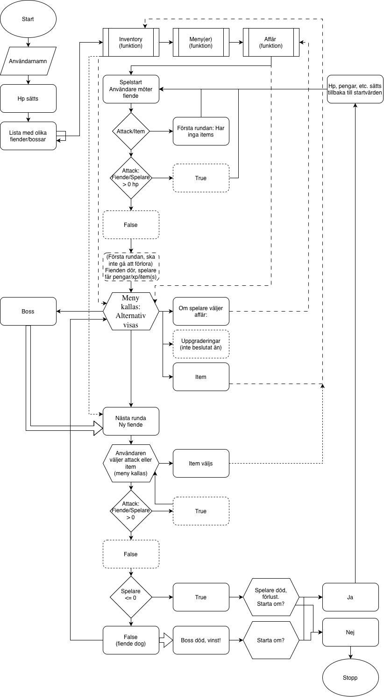

# Planering

Planera innan du skriver kod. Här bestämmer du vad ditt spel ska vara, hur kampen fungerar och
vilka kort du bygger det med. Visa planen och korten för läraren innan du börjar koda.

## Mitt spel

Jag tänker försöka bygga ett system som kommer inkludera ett system med förråd och föremål man kan använda mellan rundor (eller attackera istället), slumpade fiender varje gång, och ett upprepande system tills man kanske möter en slutboss. Varje fiende kan kanske ge pengar och/eller xp så man kan förbättra sig inför det. 

## Fyra frågor planen ska svara på

1. Var börjar programmet, och vad finns innan första turen?

    En lista med olika fiender, hälsa vid start (samt föremål, pengar, xp, vad jag nu gör), hur skadan kommer att fungera. Jag kommer troligen använda funktioner till allt detta.

2. Vad händer inuti en tur, i vilken ordning?

    Varje tur kommer användaren se sitt hp och fiendens, sedan få alternativ mellan att attackera eller att använda ett föremål. Om ett föremål används upprepas det igen tills de använder attack, funktionen för skada skörs (troligen bara "damage * xp/uppgradering" eller liknande) och menyn visas igen med de nya värdena för hp:et

3. Vad avgör om det blir en tur till?

    Allting kommer att loopas tills antingen spelaren eller fienden når 0 hp. Om fienden kommer till 0 så kanske den släpper ett föremål samt lite xp/pengar. Efter en fight kommer man till ett mellan fas där du kan uppgradera och liknande eller välja att gå till nästa fight. Det kommer även finnas ett alternativ för att avsluta som då också avslutar spelat och såklart blir det ingen tur till då. 

4. Vad händer efter sista turen?

    Sista turen blir då efter bossen. Om spelaren vinner så vinner de spelet (vinner ära) och om de förlorar blir det samma som förut.

## Min plan

Rita ett flödesschema på papper och lägg in ett foto här, eller skriv pseudokod: programmets steg
med vanliga ord, en rad per steg, utan att bry dig om Python.

 

## Mönster jag tror att jag behöver

Gå igenom Mönsterkortet med planen framför dig. Vilka mönster känner du igen?

- Inläsning
- Standardvärdet
- Tills-mönstret
- Menymönstret
- Beräknaren (troligen)
- Valideraren (sen tidigare)
- Persistent lagring (om jag har tid, inte del av planen)

## Mina kort

Kravkorten på brädet säger _vad_ spelet ska klara. De är för stora med flit, och du gör om dem till
dina egna kort, de som säger _hur_ du bygger det. Två sorters kort:

- **Delar av kraven.** Varje kravkort blir några mindre kort.
- **Mitt spel.** Minst två kort med dina egna idéer från första rubriken.

Ett bra kort ryms i en lektion, slutar med något du kan köra och se, och har ett namn som duger som
commitmeddelande. Exempel:

> **Slumpad skada:** spelarens skada slumpas mellan 5 och 15. Kör fem gånger, skadan ska variera.

"Gör kampen" är inget kort, det är fem. Vet du inte hur du ska dela upp kampen, titta på stegen på
kurswebben och gör dem till dina kort.

Skriv listan här och skapa korten efteråt, eller direkt som kort.